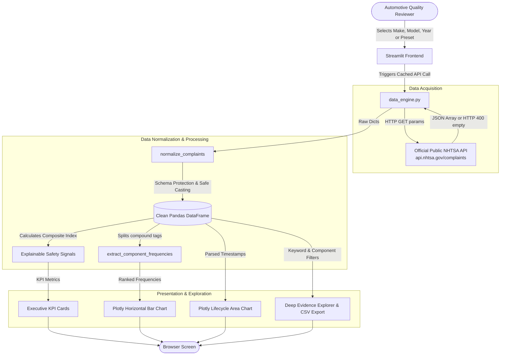

# ⚡ PartPulse — Student Learning & Presentation Guide

Welcome to the **PartPulse** learning manual. This guide is written specifically for students and aspiring automotive software engineers. It explains how the entire application works—from the underlying federal data source to the frontend interactive charts—and provides a presentation script you can use to demo the application to industry guests or interviewers.

---

## 1. System Architecture & End-to-End Data Flow

The diagram below illustrates how user actions flow through PartPulse:



---

## 2. Core Technologies Explained in Simple Terms

| Technology | What it is | Role in PartPulse |
| :--- | :--- | :--- |
| **Python** | A readable, expressive programming language. | Serves as the backbone coordinating data retrieval, processing, and application logic. |
| **Streamlit** | A reactive Python web framework. | Turns Python scripts into a reactive web interface. Whenever an input changes, Streamlit runs the script to update the UI without needing custom HTML, CSS, or JavaScript. |
| **Pandas** | A data manipulation library. | Works like a programmable spreadsheet in memory. It filters, aggregates, groups by time periods, and calculates percentages across hundreds of vehicle complaints in milliseconds. |
| **Plotly** | An interactive graphing library. | Generates responsive, interactive JavaScript charts (zoomable, hoverable, downloadable) directly from Python data. |
| **REST API** | An online interface for exchanging structured data over HTTPS. | NHTSA's federal server sends real, public consumer complaint records formatted as JSON (JavaScript Object Notation). |
| **requirements.txt** | A dependency manifesto. | Tells Python package installers (`pip`) which exact software libraries are required to run the project. |

---

## 3. Explaining the Python 3.15 / Pandas Installation Error

If you encountered a build failure when trying to install `pandas` on Python 3.15, here is why:

### The Root Cause:
1. **Python 3.15 is an experimental / pre-release version of Python.**
2. Libraries like `pandas` and `numpy` are not pure Python—they contain high-performance C and C++ extensions compiled to machine code for speed.
3. For stable Python releases (such as **Python 3.11** or **Python 3.12**), the package authors publish pre-compiled binary packages called **wheels** (`.whl`) to PyPI (Python Package Index). When you run `pip install pandas`, pip simply downloads and unzips this pre-compiled wheel.
4. Because Python 3.15 is not yet an officially supported release, **no pre-compiled binary wheels exist for it on PyPI**.
5. When `pip` cannot find a binary wheel, it attempts to download the raw source code (`.tar.gz`) and compile it on your computer using Microsoft Visual C++ Build Tools (`cl.exe`).
6. Because standard developer laptops lack the full C++ compilation toolchain and because Python's internal C-API changes between versions, compilation fails with errors like:
   ```
   error: Microsoft Visual C++ 14.0 or greater is required.
   Failed building wheel for pandas
   ```

### The Solution:
Use **Python 3.12**. In this environment, all pre-compiled wheels for Streamlit, Pandas, Plotly, and NumPy install in seconds without needing a C++ compiler.

---

## 4. Understanding Windows Port 8501 vs 8502 (`WinError 10013`)

When starting Streamlit on Windows, you may encounter:
```
PermissionError: [WinError 10013] An attempt was made to access a socket in a way forbidden by its access permissions
```
- **Why this happens**: Windows features like Hyper-V, WSL2 (Windows Subsystem for Linux), or Internet Connection Sharing periodically reserve dynamic port ranges for internal networking. Port 8501 is frequently trapped in these reserved ranges.
- **The fix**: We configured `.streamlit/config.toml` to serve on **Port 8502**, which is free and unrestricted on Windows.

---

## 5. Walkthrough of Every Project File

### 1. `app.py`
The main presentation layer. It configures the Streamlit page, applies custom automotive CSS styling (dark ink navy, warm backgrounds, teal accents, amber warning cards), renders the search console, formats KPI metric cards, displays Plotly charts, and builds the interactive evidence explorer.

### 2. `data_engine.py`
The pure data engine. It isolates all backend data processing from the UI:
- `fetch_nhtsa_complaints(make, model, year)`: Handles API requests and addresses a critical federal API edge case (when 0 complaints match, NHTSA returns HTTP 400 instead of 200).
- `normalize_complaints(raw_rows)`: Guarantees schema consistency, handles null values, parses boolean flags (`True`, `"yes"`, `1`), and extracts dates.
- `extract_component_frequencies(df)`: Splits multi-component strings (e.g. `"STEERING, SUSPENSION"`) into individual atomic components so part frequencies reflect true mechanical subsystems.

### 3. `test_app.py`
An automated test suite verifying:
- Safe conversion helpers for strings, booleans, and integers.
- Schema normalization under messy or missing data.
- Atomic component frequency extraction.
- Edge case handling when zero records are returned.

### 4. `.streamlit/config.toml`
Defines the automotive styling palette (Primary: `#0E766E` teal, Background: `#F8FAFC`, Secondary: `#FFFFFF`, Text: `#0F172A`) and binds the server to port 8502.

### 5. `requirements.txt`
Declares the project's tested, production-grade library versions.

---

## 6. How to Run the App Locally

### Quick Start:
```powershell
# 1. Navigate to the project folder
cd C:\Users\LENOVO\.gemini\antigravity\scratch\partpulse

# 2. Run the application using Python 3.12
& "C:\Users\LENOVO\.cache\codex-runtimes\codex-primary-runtime\dependencies\python\python.exe" -m streamlit run app.py --server.port 8502
```

Open your browser to: **`http://localhost:8502`**

---

## 7. Two-Minute Industry Presentation Script

Use this script when presenting PartPulse to an engineering recruiter, professor, or automotive industry reviewer:

> **[0:00 - The Hook & Problem Statement]**  
> *"Good morning. When vehicle owners experience safety or reliability issues, they submit narrative complaints to the U.S. National Highway Traffic Safety Administration (NHTSA). However, quality engineering teams at major automakers often struggle to triage these raw, unstructured public filings quickly.  
> That is why I built **PartPulse**—an automotive quality signal radar that surfaces recurring consumer concerns for technical investigation."*
>
> **[0:30 - Live Demonstration & Case Studies]**  
> *(Click the '🚙 2019 Jeep Wrangler' preset button)*  
> *"Here, we are looking at real NHTSA filings for the 2019 Jeep Wrangler. PartPulse queries the federal API live, normalizes the data, and displays key executive signals.  
> Notice that out of 750 reports, the dominant component is **Steering**—accounting for over 60% of all filings. Reviewers can immediately identify the well-known front-axle shimmy often referred to as the 'death wobble'."*
>
> **[1:00 - Data Rigor & Transparent Metrics]**  
> *"Crucially, PartPulse does not pretend to be an unexplainable AI black box, nor does it diagnose mechanical defects.  
> For instance, our **Incident Signal Index** has a transparent, published formula: the percentage of reports that explicitly flagged a crash, fire, or injury. We emphasize that raw complaint counts are **not** vehicle failure rates, because public data lacks a fleet-size sales denominator."*
>
> **[1:30 - Deep Evidence Explorer & Workflow Integration]**  
> *(Type 'wobble' into the Keyword Search box)*  
> *"A reliability engineer can drill directly into the customer narratives, review the exact symptoms reported, inspect masked VINs, and click through to official federal ODI records. They can also export the filtered dataset as a CSV to correlate with internal warranty claims and Technical Service Bulletins."*
>
> **[1:55 - Closing]**  
> *"PartPulse proves how open public data, clean Python architecture, and thoughtful UI design can transform raw federal records into an actionable quality intelligence tool. Thank you, and I welcome any questions."*
